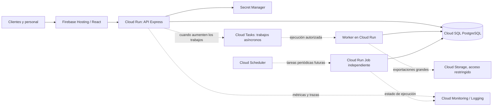
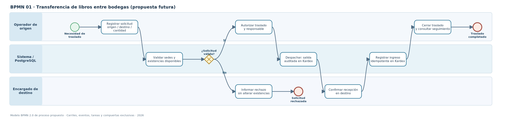
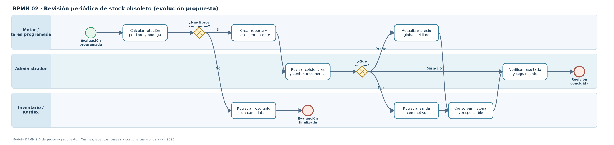
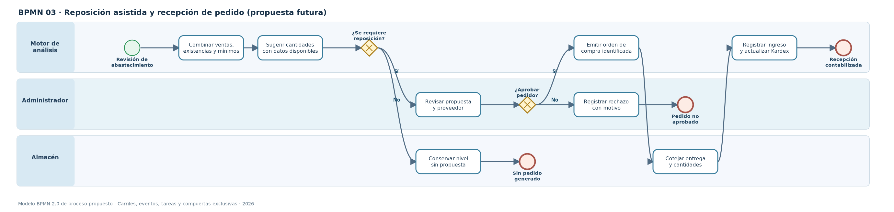

# Librería Oskar — Plan de escalabilidad futura

**Universidad de San Carlos de Guatemala (USAC) · Centro Universitario de Occidente (CUNOC)**  
**División de Ciencias de la Ingeniería · Seminario de Sistemas 1**  
**Proyecto 1 — Fase 3 · Documento de arquitectura y evolución**  
**Fecha de corte documental:** 26 de octubre de 2026  
**Clasificación:** propuesta técnica de crecimiento; no constituye una orden de despliegue.

---

## Resumen ejecutivo

Librería Oskar es una solución web para administrar libros, existencias, bodegas, ventas, movimientos de inventario y consultas públicas de catálogo. Su arquitectura utiliza **React/Vite en Firebase Hosting**, una API **Node.js/Express/Sequelize en Cloud Run** y **PostgreSQL 15 en Cloud SQL**. El control de acceso, las migraciones, los reportes y la automatización de despliegues forman parte de la base sobre la que puede crecer el sistema.

Este documento identifica los procesos que deben evolucionar, presenta **tres modelos BPMN 2.0** de procesos futuros, propone modificaciones incrementales al modelo de datos y justifica tecnologías que podrían adoptarse cuando exista demanda real. Se priorizan tres objetivos: **preservar el historial**, **incorporar nuevas operaciones comerciales sin duplicar existencias** y **aumentar capacidad solo después de medir rendimiento y costo**.

El diseño distingue expresamente entre características de la arquitectura existente, desarrollo realizado en ramas de funcionalidad y **propuestas aún no implementadas**. La integración de una rama en `develop` o su despliegue en `main` requiere verificación independiente.

## 1. Alcance y criterios de escalabilidad

La escalabilidad se aborda desde cuatro dimensiones:

| Dimensión | Objetivo | Condición de éxito |
|---|---|---|
| **Funcional** | Incorporar nuevos procesos de negocio y sucursales | No romper ventas, precios ni Kardex históricos. |
| **Datos** | Aumentar registros, reportes y auditorías | Consultas paginadas, índices medidos e integridad referencial. |
| **Operativa** | Mejorar confiabilidad, respaldos y observabilidad | Alertas accionables, restauraciones verificadas y cambios reproducibles. |
| **Infraestructura** | Atender más solicitudes sin sobredimensionar recursos | Escalado gradual con límites de costo y conexiones a PostgreSQL. |

Quedan fuera del alcance de este documento la implementación de un comercio electrónico con pagos en línea, nuevas credenciales de producción y la ejecución de migraciones. Esas iniciativas requerirían sus propios requisitos, presupuesto, pruebas y autorizaciones.

## 2. Arquitectura de referencia

### 2.1 Componentes existentes

| Capa | Componente | Función actual |
|---|---|---|
| Presentación | React + Vite / Firebase Hosting | Aplicación web, catálogo, módulos internos y HTTPS. |
| API | Node.js + Express / Cloud Run (`libreria-oskar-api`) | Autenticación, lógica comercial, inventario, ventas y reportes. |
| Persistencia | PostgreSQL 15 / Cloud SQL (`oskar-db`) | Tablas relacionales, restricciones, transacciones y auditoría de movimientos. |
| Datos y ORM | Sequelize + SQL versionado | Modelos, consultas, migraciones y pruebas de integración. |
| Construcción y despliegue | GitHub Actions, Cloud Build, Artifact Registry | Validación, imágenes y despliegue continuo en la rama autorizada. |
| Tareas operativas | Cloud Run Jobs | Migraciones y procesamiento de alertas de inventario. |
| Seguridad | Secret Manager, identidades de servicio, HTTPS, roles, 2FA | Protección de credenciales y operaciones administrativas. |
| Continuidad | Respaldos automáticos de Cloud SQL y Runbook | Base de recuperación y operación; la restauración debe comprobarse periódicamente. |
| Infraestructura como código | Terraform | Definición versionada de recursos y permisos cloud. |

En el diagrama de despliegue compartido para Fase 3, el servicio de API se mantiene inicialmente con **mínimo 0 y máximo 1 instancia**. Es una configuración conservadora para el alcance académico, no una limitación de la plataforma. Los parámetros reales deben contrastarse con la revisión desplegada antes de modificarlos.

### 2.2 Funcionalidad disponible y evolución inmediata

- **Módulos base:** catálogo, registro de libros, categorías, inventario por bodega, Kardex, ventas y anulaciones, usuarios, reportes PDF/XLSX, 2FA y recuperación de contraseña.
- **Alertas de stock mínimo:** desarrollo integrado en `develop` y Job creado según coordinación del equipo; al corte documental estaba pendiente confirmar la activación de su programación en Cloud Scheduler.
- **Gestión de sucursales y bodegas (HU-03):** implementación y pruebas de la rama `feature/gestion-sucursales`, con migración **021**. La publicación de la rama no equivale por sí sola al despliegue productivo.
- **Reporte de stock obsoleto comercial:** implementación y pruebas de la rama `feature/gestion-stock-obsoleto`, con migración **022** que agrega índices. Separa las ventas comerciales completadas de los movimientos administrativos; el informe mensual por correo no forma parte de esa entrega.

### 2.3 Evolución de arquitectura, condicionada a métricas

**Lectura del diagrama:** líneas continuas representan la base de interacción; las líneas punteadas representan integraciones **propuestas o condicionadas**. No se afirma que Cloud Tasks, un worker adicional o Cloud Storage estén habilitados actualmente.

## 3. Inventario de procesos de negocio

La definición de procesos de la Fase 1 identifica once procesos. La tabla los relaciona con la evolución del sistema y distingue las mejoras propuestas:

| N.º | Proceso identificado | Enfoque de evolución |
|---:|---|---|
| 1 | Registro e ingreso de productos | Recepciones verificables por bodega; evitar duplicados por ISBN. |
| 2 | Catalogación y clasificación temática | Calidad de metadatos, categorías y posible consolidación de duplicados. |
| 3 | Monitoreo de stock mínimo | Reposición fundamentada en demanda y cobertura, no solo mínimo fijo. |
| 4 | Notificación y alerta de reabastecimiento | Programación confiable, entrega idempotente y seguimiento del aviso. |
| 5 | Detección y notificación de stock obsoleto | Revisión comercial por bodega; aviso mensual y seguimiento de decisiones. |
| 6 | Gestión de liquidaciones, descuentos y bajas | Historial de autorizaciones; eventual devolución documentada a proveedor. |
| 7 | Ajuste y auditoría de inventario (Kardex) | Trazabilidad de transferencias entre bodegas y de recepciones. |
| 8 | Generación y exportación de reportes de auditoría | Exportaciones grandes asíncronas, control de acceso y caducidad. |
| 9 | Búsqueda y filtrado avanzado | Optimización e índices a partir de consultas y uso reales. |
| 10 | Ficha técnica y reseña de libros | Enriquecimiento de datos y consistencia de información pública. |
| 11 | Verificación física de disponibilidad | Existencias confiables por sede y futuras reservas únicamente con un modelo explícito. |

Los tres diagramas siguientes profundizan en **procesos de crecimiento** ligados a los procesos 3–8. No sustituyen los diagramas originales de Fase 1 para aquellas operaciones que ya están implementadas.

## 4. Procesos futuros diagramados en BPMN 2.0

Las ilustraciones muestran **eventos de inicio/fin (círculos), actividades (rectángulos redondeados), decisiones exclusivas (rombos) y carriles de responsabilidad**. Se adjuntan además archivos **`.bpmn` editables** con elementos BPMN 2.0 y coordenadas de diagrama; pueden revisarse en un modelador compatible.

### 4.1 BPMN 01 — Transferencia de libros entre bodegas

**Finalidad.** Transferir existencias de una bodega de origen a otra de destino sin perder trazabilidad, evitando la doble contabilización y preservando los responsables.

**Entrada:** libro, origen, destino, cantidad, solicitante y motivo. **Salida:** transferencia cerrada con salida y entrada vinculadas en Kardex, o solicitud rechazada sin alteración de existencias.

**Reglas de diseño:**

1. Origen y destino deben ser diferentes y operativos; la cantidad es positiva y no supera las existencias disponibles.
2. Una solicitud pasa por estados como `Solicitada → Autorizada → En tránsito → Recibida`, con `Rechazada` y `Cancelada` como estados terminales alternos definidos por política.
3. La **salida en origen** se confirma mediante una transacción local; la **entrada en destino** ocurre tras confirmar la recepción física. No se promete una transacción PostgreSQL abierta durante el traslado.
4. Deben existir claves de idempotencia para evitar registrar dos veces la recepción y referencias explícitas entre transferencia, líneas y movimientos.
5. Si se cancela una transferencia despachada, debe documentarse un retorno o movimiento compensatorio; nunca borrar movimientos históricos.

**Archivo editable:** [`bpmn-transferencia-bodegas.bpmn`](diagramas/bpmn-transferencia-bodegas.bpmn).

### 4.2 BPMN 02 — Evaluación periódica de stock obsoleto

**Finalidad.** Extender el reporte comercial para generar un proceso de revisión periódica y registrar acciones de gestión sobre libros sin ventas recientes.

**Entrada:** período sin ventas, sucursal/bodega, existencias y ventas completadas. **Salida:** reporte de candidatos, decisión documentada y, cuando se autorice, ajuste de precio o baja justificada.

**Reglas de diseño:**

1. La obsolescencia comercial se determina con **ventas `Completada`**, excluyendo ventas anuladas y movimientos administrativos. Se evalúa por libro/bodega y solo con existencias positivas.
2. La ventana predeterminada definida para el nuevo reporte es **180 días**, ajustable por el Administrador. La métrica histórica de inventario “sin movimientos de Salida” es diferente y debe permanecer identificada como tal.
3. Cambiar el precio de un libro afecta el precio vigente global y no debe alterar los importes históricos de ventas.
4. La baja de existencias se realiza a través de una salida con motivo, reflejada en Kardex; no mediante `DELETE` ni actualizando `stock_actual` directamente.
5. Una futura notificación mensual debe almacenar fecha/período, destinatario y estado de entrega para impedir envíos duplicados. **El correo mensual no se considera implementado**.

**Archivo editable:** [`bpmn-revision-stock-obsoleto.bpmn`](diagramas/bpmn-revision-stock-obsoleto.bpmn).

### 4.3 BPMN 03 — Reposición asistida y recepción documentada

**Finalidad.** Evolucionar del indicador de bajo stock a una propuesta de compra revisable por el Administrador y a una recepción verificable por el almacén.

**Entrada:** existencias, mínimos, ventas completadas por período y datos del proveedor. **Salida:** propuesta rechazada o pedido autorizado con recepción y movimientos auditados.

**Reglas de diseño:**

1. El sistema **sugiere**, no compra automáticamente. Sin costos ni tiempos reales de abastecimiento no corresponde presentar una cantidad óptima como dato confiable.
2. La aprobación debe guardar usuario, fecha, motivo, proveedor y líneas de pedido; deben controlarse duplicados y cambios de estado.
3. La recepción debe contrastar cantidades recibidas y pedidas. Solo lo efectivamente recibido genera entradas en Kardex.
4. El vínculo entre proveedor, orden, recepción y movimientos requiere entidades nuevas; **no está implementado en la plataforma actual**.

**Archivo editable:** [`bpmn-reposicion-asistida.bpmn`](diagramas/bpmn-reposicion-asistida.bpmn).

## 5. Evolución propuesta del modelo de datos

### 5.1 Línea base y numeración

El esquema existente ya modela `sucursales`, `bodegas`, `inventarios`, `movimientos_inventario`, `libros`, `ventas` y `venta_detalles`; también hay control versionado con `schema_migrations`.

Las migraciones recientes tienen propósitos concretos:

| Migración | Finalidad | Tratamiento documental |
|---|---|---|
| `020_alertas_stock_minimo.sql` | Reportes y entregas de alertas de bajo stock | Desarrollo existente; no redefinirla como futura. |
| `021_gestion_sucursales.sql` | Protección de relaciones históricas mediante restricciones `RESTRICT` | Creada en la rama de sucursales; comprobar integración antes de desplegar. |
| `022_gestion_stock_obsoleto.sql` | Índices para consultas por ventas y primeras entradas | Validada en PostgreSQL de pruebas; revisar bloqueo de escrituras al aplicarla. |

**Los números 023 en adelante indicados a continuación son ilustrativos, no están reservados ni constituyen scripts implementados.** El número definitivo se asignará al crear cada PR, previa actualización desde `develop`.

### 5.2 Migración futura A — Transferencias internas entre bodegas

**Nombre tentativo:** `023_transferencias_bodegas.sql`.

| Entidad propuesta | Campos esenciales | Reglas y vínculos |
|---|---|---|
| `transferencias` | `id`, `bodega_origen_id`, `bodega_destino_id`, `solicitada_por`, `autorizada_por`, `estado`, `motivo`, fechas | FKs a bodegas y usuarios; impedir origen=destino; baja física prohibida si existe historial. |
| `transferencia_detalles` | `id`, `transferencia_id`, `libro_id`, `cantidad_solicitada`, `cantidad_despachada`, `cantidad_recibida` | Cantidades positivas; relación única por transferencia/libro según reglas de negocio. |
| Referencias en `movimientos_inventario` | `transferencia_id` y rol `origen/destino`, o tabla puente | Cada entrada/salida vinculada a una transferencia y protegida contra repetición. |

**Datos previos:** no inventar transferencias históricas. Migrar solamente cuando exista el flujo operacional validado. **Compatibilidad:** introducir primero tablas y columnas opcionales; luego backend transaccional, pruebas de concurrencia, frontend y restricciones finales.

### 5.3 Migración futura B — Proveedores, órdenes y recepción

**Nombre tentativo:** `024_compras_proveedores.sql`.

| Entidad propuesta | Campos esenciales | Consideración |
|---|---|---|
| `proveedores` | `id`, `nombre`, datos de contacto, `activo` | No asumir datos fiscales o políticas de pago hasta levantamiento de requisitos. |
| `ordenes_compra` | `id`, `proveedor_id`, `bodega_id`, `estado`, `solicitada_por`, `aprobada_por`, fechas | Flujo de aprobación y estado auditable. |
| `orden_compra_detalles` | `orden_id`, `libro_id`, `cantidad`, `costo_unitario` (si se captura) | No inferir costos a partir del precio de venta. |
| `recepciones` / `recepcion_detalles` | Orden asociada, cantidades verificadas, responsable y fecha | Vincular cada recepción a entradas de Kardex, incluyendo entregas parciales. |

**Dependencia funcional:** la reposición asistida puede analizar ventas antes de contar con proveedores; **la compra formal** requiere estas entidades y una política de recepción.

### 5.4 Migración futura C — Seguimiento de decisiones sobre obsolescencia

**Nombre tentativo:** `025_seguimiento_obsolescencia.sql`.

- Tabla de **revisiones** con período evaluado, fecha, filtros y responsable.
- Tabla de **acciones** con inventario, tipo (`Observación`, `CambioPrecio`, `BajaJustificada`), motivo, estado, usuario, referencia del movimiento y fecha.
- Vínculo a ventas/precios históricos solo cuando el requisito comercial lo amerite; una baja o cambio de precio ya se ejecuta con operaciones existentes.
- Evitar almacenar un indicador `obsoleto` permanente que pueda quedar desactualizado; calcular la rotación desde ventas completadas y conservar **solo decisiones y evidencias**.

### 5.5 Migración futura D — Envío periódico de reportes y exportaciones

**Nombre tentativo:** `026_ejecuciones_programadas.sql`, solo si no puede reutilizarse de forma segura una estructura existente.

- Registrar clave única por proceso, período y destinatario; estado, intentos, fecha de ejecución y error sanitizado.
- Guardar metadatos del archivo generado, fecha de vencimiento y propietario **sin almacenar rutas públicas permanentes**.
- Gestionar reintentos como operaciones idempotentes; no asumir “exactamente una vez” solo por utilizar una cola.
- Configurar retención y borrado de archivos temporales según política aprobada.

### 5.6 Procedimiento obligatorio para cada migración futura

1. Crear rama desde `develop` actualizado y confirmar números disponibles en `app/database/migrations/`.
2. Preparar SQL incremental y transaccional cuando sea posible; actualizar también `schema.sql`, modelos Sequelize y documentación.
3. Evaluar volumen existente, claves foráneas, índices y posibles bloqueos. Considerar estrategias compatibles de creación de índices para producción.
4. Ejecutar en `libreria_oskar_test`, sin `seed()` sobre la base local de desarrollo y sin conexión a Cloud SQL productiva.
5. Probar datos existentes, reintentos, idempotencia, concurrencia y compatibilidad de API con código anterior/nuevo.
6. Tomar y verificar un respaldo antes de desplegar; coordinar con el responsable de producción la ventana de aplicación y la recuperación.
7. Registrar evidencia de aplicación; no prometer rollback automático de una migración destructiva. Preferir estrategia **expandir → migrar datos → cambiar código → contraer**.

## 6. Tecnologías de crecimiento y justificación

Las siguientes son **opciones condicionadas a necesidades verificables**, no componentes que deban instalarse inmediatamente.

| Tecnología o capacidad | Uso futuro | Justificación | Requisito antes de adoptarla |
|---|---|---|---|
| **Cloud Run: mayor máximo de instancias y concurrencia ajustada** | Incrementar solicitudes a la API | Escalado horizontal sin administrar servidores | Medir p95, conexiones totales y costo; establecer límite inicial conservador. |
| **Cloud Monitoring / Cloud Logging** | Alertar por errores, latencia, saturación y fallas de Jobs | Reduce tiempos de diagnóstico y facilita evidencia operativa | Definir responsables, umbrales, retención y evitar registrar secretos. |
| **Cloud Tasks + worker Cloud Run** | Exportaciones grandes, correos y operaciones lentas | Desacopla trabajos de la petición HTTP y ofrece controles de reintento | Idempotencia, autenticación del worker, límites de envío y costos. |
| **Cloud Storage privado** | Archivos de exportación temporal | Evita mantener archivos pesados en memoria de la API | Cifrado, IAM, vencimiento, firma de acceso y borrado periódico. |
| **Cloud Scheduler + Job independiente** | Reporte mensual de stock obsoleto | Programa tareas sin proceso cron permanente | Persistencia de ejecuciones y entregas; IAM mínimo; aprobación del equipo. |
| **Cloud SQL: PITR y alta disponibilidad** | Mejora del objetivo de recuperación y continuidad | Disminuye impacto de fallas y permite recuperación más precisa cuando está habilitado | Verificar edición, costos, retención, réplica y prueba real de restauración. |
| **Read replica o caché** | Lecturas intensivas del catálogo | Aislar lecturas de la base primaria y reducir consultas repetidas | Pruebas de carga; estrategia de coherencia; valorar costo antes de agregar. |
| **Playwright (pruebas E2E)** | Validar flujos críticos desde navegador | Detecta fallos que no cubren pruebas de servicios | Ambiente aislado, datos de prueba y ejecución en CI controlada. |

### 6.1 Política de escalado de API y base de datos

Cloud Run puede aumentar instancias dentro de sus límites configurados, pero **cada instancia puede abrir conexiones a Cloud SQL**. Antes de subir `max instances` se debe estimar la presión máxima sobre el pool y PostgreSQL. Como regla de diseño, revisar:

- Capacidad total estimada: **instancias simultáneas × conexiones máximas por pool**, más conexiones de Jobs, migraciones y administradores.
- Concurrencia real por instancia; si el backend se satura en CPU o espera conexiones, aumentar solo instancias puede empeorar la base de datos.
- Consultas `EXPLAIN (ANALYZE, BUFFERS)` con datos de prueba representativos para reportes por fecha, libro y bodega.
- Contención de escrituras en ventas, ajustes y transferencias; mantener transacciones breves, claves únicas, bloqueos consistentes y pruebas de carrera.
- Presupuesto y alertas: más instancias, servicios adicionales y mayor disponibilidad **pueden aumentar costos**; ningún cambio debe aplicarse sin autorización.

### 6.2 Indicadores y disparadores de cambio

Los valores siguientes son **objetivos iniciales sugeridos**, no mediciones actuales ni acuerdos de servicio aprobados:

| Indicador | Umbral orientativo | Acción propuesta |
|---|---|---|
| Latencia p95 de API de lectura | > 1 s de forma sostenida | Diagnosticar consulta, caché, tamaño de instancia o escalado. |
| Errores HTTP 5xx | > 1 % durante 15 min | Investigar despliegue, dependencias, límites y disponibilidad de BD. |
| Pool de conexiones PostgreSQL | > 80 % sostenido | Reducir concurrencia, revisar fugas, ampliar capacidad solo si se justifica. |
| Reporte PDF/XLSX | Límite actual de 5.000 filas por exportación | Proponer generación asíncrona/streaming antes de aumentar el límite. |
| Fallas del proceso programado | Una ejecución programada con error no recuperado | Notificar responsable y seguir Runbook, sin reintentos ciegos. |
| Crecimiento de datos | Tendencia sostenida que degrade p95 o backups | Revisar índices, particionado futuro y política de archivado. |

**Observación:** la recuperación de contraseñas, 2FA, alertas y cualquier contador de tasa basado en memoria de una sola instancia debe revisarse al escalar a varias réplicas. Compartir estado sensible exige controles adecuados, no simplemente aumentar instancias.

## 7. Seguridad, disponibilidad y continuidad

La expansión no debe reducir controles ya incorporados. Se establecen estas políticas de diseño:

- Mantener **HTTPS**, validación del JWT/sesión, autorización por rol y operaciones de Administrador protegidas tanto en frontend como backend.
- Usar cuentas de servicio específicas y **mínimo privilegio**; no reutilizar credenciales personales ni registrar secretos en repositorio, logs o diagramas.
- Separar ambientes y bases de prueba/producción. Los datos productivos no se usan directamente en pruebas de carga ni demostraciones destructivas.
- Conservar **Kardex inmutable por eventos compensatorios**: correcciones, anulaciones y traslados generan nuevos movimientos, nunca borran evidencia histórica.
- Mantener respaldos automáticos y realizar restauraciones periódicas **en una instancia aislada**. Un respaldo programado por sí solo no prueba recuperabilidad.
- Definir **RPO y RTO** mediante acuerdo con la librería. No se puede afirmar un valor sin conocer frecuencia de respaldos, PITR, tamaño y resultados de simulacros.
- Antes de nuevas migraciones o cambios de escalado, coordinar respaldo manual, plan de reversión de aplicación y validación postdespliegue, de acuerdo con `RUNBOOK.md`.

## 8. Plan de implementación por etapas

| Horizonte | Trabajo | Dependencias | Evidencia de aceptación |
|---|---|---|---|
| **Etapa 0 — Consolidación** | Integrar PR de sucursales y PR de stock obsoleto; finalizar validaciones de despliegue; probar Scheduler de alertas | Revisiones de código y autorización del responsable de producción | Suite completa en `develop`, migraciones aplicadas, pruebas manuales y evidencia de Jobs. |
| **Etapa 1 — Observabilidad** | Establecer paneles de errores, latencia, conexiones y backups | IAM, presupuesto y lineamientos de registro | Alertas probadas, trazas útiles y responsable asignado. |
| **Etapa 2 — Traslados** | Implementar solicitud, autorización, despacho y recepción | Migración futura de transferencias y reglas de stock | Pruebas de concurrencia, idempotencia y Kardex conciliado. |
| **Etapa 3 — Gestión comercial** | Revisión mensual de obsoletos y compras/recepciones formales | Definición de proveedores, costos y políticas de liquidación | Historial de decisiones, pedidos y movimientos vinculados. |
| **Etapa 4 — Capacidad** | Ajustar Cloud Run y PostgreSQL; evaluar workers y exportaciones asíncronas | Métricas que justifiquen el cambio y estimación de costos | Pruebas de carga comparativas, rollback y presupuesto aprobado. |

### 8.1 Criterios para aceptar una evolución

Una ampliación se considera técnicamente apta cuando: (1) existe una historia de usuario validada; (2) las relaciones históricas permanecen intactas; (3) hay pruebas automáticas y manuales sobre datos de ensayo; (4) se dispone de evidencia de recuperación; (5) IAM, costos y rendimiento fueron revisados; y (6) su PR llega a `develop` antes de que el responsable decida el despliegue a `main`.

## 9. Riesgos y medidas de mitigación

| Riesgo | Impacto | Mitigación |
|---|---|---|
| Escalar la API sin dimensionar conexiones | Bloqueo o saturación de Cloud SQL | Presupuesto de conexiones y prueba de carga gradual. |
| Duplicar recepción o envío por reintentos | Existencias o correos incorrectos | Claves idempotentes, restricciones únicas y transacciones. |
| Cambiar precio sin contexto multisucursal | Liquidación aplicada a todas las bodegas | Confirmación explícita; futura política de precios local si el negocio la solicita. |
| Usar `DELETE CASCADE` sobre registros históricos | Pérdida de trazabilidad | Baja lógica, FKs protectoras y pruebas de integridad. |
| Crear índices en BD activa sin medir bloqueos | Escrituras detenidas temporalmente | Evaluar ventana, tamaño, tipo de índice y estrategia de migración. |
| Asumir restauración por tener backups | Interrupción prolongada o pérdida de datos | Simulacros de recuperación y RPO/RTO medidos. |
| Archivos exportados con datos de clientes expuestos | Divulgación de información | Storage privado, acceso temporal y retención mínima. |
| Agregar servicios sin necesidad de escala | Costos innecesarios | Incorporación por etapas con métricas y aprobación. |

## 10. Evidencias y anexos

**Anexos BPMN incluidos con este documento** (rutas relativas a `app/docs/`):

| Proceso | Vista integrada en GitHub | Archivo editable BPMN 2.0 | Vectorial |
|---|---|---|---|
| Transferencia entre bodegas | `diagramas/bpmn-transferencia-bodegas.png` | `diagramas/bpmn-transferencia-bodegas.bpmn` | `diagramas/bpmn-transferencia-bodegas.svg` |
| Revisión de stock obsoleto | `diagramas/bpmn-revision-stock-obsoleto.png` | `diagramas/bpmn-revision-stock-obsoleto.bpmn` | `diagramas/bpmn-revision-stock-obsoleto.svg` |
| Reposición asistida | `diagramas/bpmn-reposicion-asistida.png` | `diagramas/bpmn-reposicion-asistida.bpmn` | `diagramas/bpmn-reposicion-asistida.svg` |

Documentos vinculados en el repositorio:

- `app/docs/PROJECT_SPECS.md`: contratos, entidades, rutas y tecnologías actuales.
- `app/docs/RUNBOOK.md`: despliegue, respaldo, recuperación y operación.
- `app/docs/manuales/Manual_Tecnico_Libreria_Oskar_Fase3.pdf`: arquitectura y trazabilidad técnica.
- `app/docs/manuales/Manual_Usuario_Libreria_Oskar_Fase3.pdf`: procedimientos para usuarios finales.
- `app/docs/diagramas/`: diagramas de arquitectura y procesos disponibles.

### Fuentes técnicas consultadas

1. Google Cloud, [Límites de instancias de Cloud Run](https://docs.cloud.google.com/run/docs/configuring/max-instances) y [concurrencia](https://docs.cloud.google.com/run/docs/about-concurrency).
2. Google Cloud, [Alta disponibilidad de Cloud SQL para PostgreSQL](https://docs.cloud.google.com/sql/docs/postgres/high-availability) y [recuperación de respaldos](https://docs.cloud.google.com/sql/docs/postgres/backup-recovery/restore).
3. Google Cloud, [Cloud Tasks y procesamiento asíncrono](https://docs.cloud.google.com/tasks/docs/dual-overview).
4. Google Cloud, [Ejecución programada con Cloud Scheduler](https://docs.cloud.google.com/run/docs/triggering/using-scheduler).
5. Librería Oskar, documentación académica de **Fase 1**, historias de usuario de Fase 1 y especificaciones técnicas de **Fase 3**.

---

**Conclusión.** La arquitectura de Librería Oskar permite crecer de forma incremental, pero la expansión debe estar dirigida por necesidades comerciales verificadas. La prioridad propuesta es consolidar la integridad del inventario multisucursal, formalizar traslados y recepciones, y usar mediciones operativas antes de agregar recursos o servicios. Los diagramas y migraciones aquí definidos constituyen una **ruta de evolución**, no funcionalidades desplegadas.
