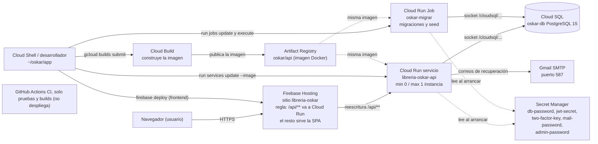

# Runbook de despliegue y operación — Librería Oskar

## 1. Qué es este documento y cómo leerlo

Este documento explica cómo está publicado el sistema en Google Cloud y cómo hacer las tareas de mantenimiento (publicar una versión nueva, volver atrás, respaldar, rotar claves, revisar errores). Está escrito para personas sin experiencia en la nube: cada término técnico se explica la primera vez que aparece.

- **Google Cloud**: la plataforma de Google donde corre el sistema. El proyecto se llama `libreria-oskar-seminario` y la región (el centro de datos) es `us-central1`.
- **`gcloud`**: el programa de línea de comandos para manejar Google Cloud.
- **Cloud Shell**: una terminal que Google ofrece dentro del navegador, con `gcloud`, `git` y `node` ya instalados. Usa `bash`.
- **Laptop (zsh)**: la terminal de la computadora personal.

**Dónde se pega cada comando.** Cada bloque de comandos empieza con una línea que dice **Cloud Shell (bash)** o **Laptop (zsh)**. Pégalo solo ahí. Los despliegues se hacen hoy desde Cloud Shell; el repositorio está clonado en `~/oskar` (rama `develop`) y la carpeta de trabajo es `~/oskar/app`.

**Marcas de estado.** Cada procedimiento lleva una de estas marcas (el detalle está en la sección 11):

- **Ejecutado en producción**: se hizo de verdad en este sistema y funcionó.
- **No probado**: está escrito a partir de la documentación oficial o de memoria, pero nunca se ejecutó aquí. Pruébalo con cuidado y avisa si algo difiere.
- **POR VERIFICAR / POR PROBAR**: el comando o un detalle no está confirmado; no lo ejecutes a ciegas.

**Reglas de seguridad.** Nunca pegues contraseñas, llaves ni códigos de autorización en un chat, correo o commit. Este documento no contiene valores secretos, solo nombres.

---

## 2. Arquitectura y diagrama de despliegue

En palabras simples: el navegador entra a **Firebase Hosting**, que entrega las páginas del sitio (la SPA, una aplicación web de una sola página) y reenvía todo lo que empieza con `/api/` al servicio **Cloud Run**, que ejecuta el backend (Node.js + Express). El backend guarda los datos en **Cloud SQL** (PostgreSQL administrado por Google) y lee sus claves de **Secret Manager**.



Las flechas punteadas son lecturas o relaciones, no acciones manuales. El nodo de GitHub Actions no tiene ninguna flecha: no participa en el despliegue y solo valida el código (`.github/workflows/ci.yml` en la raíz del repositorio, líneas 1-3).

### Tabla de recursos

| Recurso | Nombre | Para qué sirve |
|---|---|---|
| Proyecto | `libreria-oskar-seminario` | Contenedor de todo lo demás. Región `us-central1`. |
| Cloud Run servicio | `libreria-oskar-api` | Ejecuta el backend. Cuenta de servicio `oskar-api` (la identidad con la que el servicio pide permisos). `--min-instances 0 --max-instances 1`. Se conecta a la BD por el socket `/cloudsql/libreria-oskar-seminario:us-central1:oskar-db`. |
| Cloud Run Job | `oskar-migrar` | Misma imagen que el servicio. Ejecuta `node src/database/migrate.js && node src/database/seed.js`. Se lanza a mano. |
| Cloud SQL | `oskar-db` | PostgreSQL 15, máquina `db-f1-micro`, base `libreria_oskar`, usuario `oskar_app`. Respaldo automático diario (ventana de 4 h desde las 08:00 UTC), se conservan 7. |
| Secret Manager | `db-password`, `jwt-secret`, `two-factor-key`, `mail-password`, `admin-password` | Guarda las claves; ver sección 3. |
| Artifact Registry | `us-central1-docker.pkg.dev/libreria-oskar-seminario/oskar/api` | Almacén de imágenes. La etiqueta (tag) es el hash corto del commit; la vigente hoy es `c5f0cba`. |
| Cloud Build | (servicio de Google) | Construye la imagen desde `~/oskar/app` en Cloud Shell. |
| Firebase Hosting | sitio `libreria-oskar` (https://libreria-oskar.web.app) | Sirve el frontend y reenvía `/api/**` al servicio. |
| Correo | Gmail SMTP, puerto 587 | Contraseña de aplicación (clave especial de Google para programas). La cuenta remitente es también el Administrador central. |
| GitHub Actions | `.github/workflows/ci.yml` (raíz del repo) | Solo pruebas y builds. **No despliega.** |

**Por qué solo una instancia.** El limitador de intentos de login guarda sus contadores en la memoria de cada proceso (`backend/src/middlewares/rateLimit.js:8`). Con varias instancias, cada una contaría por separado; con `--max-instances 1` el conteo es consistente. Con `--min-instances 0` el servicio se apaga si nadie lo usa y la primera visita tarda unos segundos más ("arranque en frío").

**Verificado en el código**

- La carpeta del frontend publicada es `frontend/dist`; el sitio es `libreria-oskar`; `/api/**` se reescribe hacia el servicio `libreria-oskar-api` en `us-central1`, y todo lo demás cae en `/index.html`: `firebase.json:3-4, 8-12, 14-17`.
- El proxy: `app.set('trust proxy', env.trustProxy)` en `backend/src/app.js:15`; `TRUST_PROXY` (por defecto 0) y `LOGIN_RATE_LIMIT` (por defecto 10) se leen en `backend/src/config/security.config.js:33-34`. En producción están puestos a `TRUST_PROXY=1` y `LOGIN_RATE_LIMIT=100` de forma **provisional** (decididos mirando `X-Forwarded-For`).

---

## 3. Variables y secretos

Una **variable de entorno** es un valor que el programa lee al arrancar. Un **secreto** es una variable sensible guardada en Secret Manager; Cloud Run la entrega al programa como variable de entorno. Esta tabla no contiene valores.

### Secretos (Secret Manager)

| Secreto | Variable | Servicio | Job | Qué pasa si falta |
|---|---|---|---|---|
| `db-password` | `DB_PASSWORD` | sí | sí | **No hay error claro de configuración**: el código usa una contraseña por defecto (`backend/src/config/env.js:49`) y la conexión a PostgreSQL falla por credenciales (código `28P01`, tratado como fatal, sin reintentos: `backend/src/database/esperarBaseDatos.js:23`). `/api/health` responde 503 y el Job termina con error. |
| `jwt-secret` | `JWT_SECRET` | sí | sí | En producción el proceso **no arranca** (`backend/src/config/env.js:15-18`). Se carga al importar la configuración, así que también afecta al Job. |
| `two-factor-key` | `TWO_FACTOR_ENCRYPTION_KEY` | sí | sí | En producción el proceso **no arranca** (`backend/src/config/twoFactor.config.js:36`). Debe ser de 64 caracteres hexadecimales (32 bytes), si no, tampoco arranca (`twoFactor.config.js:41-42`). |
| `mail-password` | `MAIL_PASSWORD` | sí | sí | El proceso arranca, pero con `MAIL_PROVIDER=smtp` (valor por defecto en producción) los correos fallan: solo se imprime un aviso (`backend/src/config/mail.config.js:41-42`, `backend/src/config/env.js:26-28`). Afecta a "olvidé mi contraseña". |
| `admin-password` | `SEED_ADMIN_PASSWORD` | no | sí | Solo la usa el Job, y solo si el Administrador central **aún no existe**: sin ella (o si no cumple la política de contraseñas) `seed.js` falla (`backend/src/database/seed.js:35-38`). |

> **Nota: el Job necesita el mismo entorno que el servicio.** Tanto `migrate.js` como `seed.js` y `reset-2fa.js` importan la configuración (`backend/src/config/sequelize.js:2` carga `./env`), y `env.js` lanza error en producción si faltan `JWT_SECRET` (`env.js:15-18`), `TWO_FACTOR_ENCRYPTION_KEY` (`twoFactor.config.js:36`) o `CORS_ORIGINS` (`security.config.js:17`). Por eso el Job no basta con sus propios secretos: debe tener también `JWT_SECRET`, `TWO_FACTOR_ENCRYPTION_KEY`, `CORS_ORIGINS` y las variables `DB_*` (`DB_HOST`, `DB_NAME`, `DB_USER`, `DB_PASSWORD`, `DB_PORT`), además de `SEED_ADMIN_EMAIL` y `SEED_ADMIN_PASSWORD`.

### Variables solo del Job (siembra del Administrador central)

| Variable | Origen | Qué pasa si falta |
|---|---|---|
| `SEED_ADMIN_EMAIL` | Variable no secreta del Job | **Obligatoria en producción**: sin ella `seed.js` falla antes de tocar nada (`backend/src/database/seed.js:13-14`); debe ser un correo válido (`seed.js:15-17`). |
| `SEED_ADMIN_PASSWORD` | Secreto `admin-password` (solo el Job) | Solo se usa si el Administrador central aún no existe; sin ella, o si no cumple la política de contraseñas, `seed.js` falla (`seed.js:35-38`). Si el administrador ya existe no se lee y nunca se modifica (`seed.js:21-22, 54-61`). |

### Variables no secretas (se ven en la configuración del servicio)

| Variable | Origen | Qué pasa si falta |
|---|---|---|
| `NODE_ENV=production` y `PORT=8080` | Dockerfile (`backend/Dockerfile:35-36`) | Vienen en la imagen. |
| `MIGRATIONS_DIR` | Dockerfile (`backend/Dockerfile:48`) | Viene en la imagen; apunta a `/usr/src/app/database/migrations`. |
| `DB_HOST`, `DB_NAME`, `DB_USER`, `DB_PORT` | Configuración del servicio y del Job | `DB_HOST` es el socket de Cloud SQL. Si faltan se usan valores locales (`localhost`, `libreria_oskar`, `postgres`, 5432) y la conexión falla (`backend/src/config/env.js:46-50`). |
| `CORS_ORIGINS` | Configuración del servicio **y del Job** | En producción el proceso **no arranca** sin ella (`backend/src/config/security.config.js:17`). Como el Job carga la misma configuración, también la necesita. |
| `FRONTEND_URL` | Configuración del servicio | Solo aviso: sin ella la recuperación de contraseña no envía enlaces (`backend/src/config/recuperacion.config.js:34`, `env.js:36-39`). |
| `MAIL_USER` (y opcionalmente `MAIL_FROM`, `MAIL_HOST`, `MAIL_PORT`) | Configuración del servicio | Sin `MAIL_USER` los correos fallan (`mail.config.js:41`). Por defecto `smtp.gmail.com` y 587 (`mail.config.js:5-6`). |
| `SEED_EMPLEADO_PASSWORD` | Opcional (Job) | Si falta, en producción solo se avisa y no se crea el empleado de ejemplo (`seed.js:164-165`). |
| `TRUST_PROXY`, `LOGIN_RATE_LIMIT` | Configuración del servicio | Provisionales: `1` y `100`. Sin ellas: 0 y 10 (`security.config.js:33-34`); con 0 el limitador vería la IP del proxy de Google y todos los usuarios compartirían el mismo contador. |
| `TWO_FACTOR_ENFORCED` | Opcional | Por defecto está **activo** en producción: el segundo factor es obligatorio para Administrador y Empleado (`twoFactor.config.js:25`). |
| `DB_CONNECT_MAX_WAIT_MS` | Opcional | Por defecto, en producción, el servidor y los scripts reintentan conectar hasta 120 000 ms (`backend/src/database/esperarBaseDatos.js:17, 26-28`). |

**Dónde ver los nombres de los secretos** (sin valores):

Cloud Shell (bash)
```bash
gcloud secrets list --format="value(name)"
```
Marca: **Ejecutado en producción**.

---

## 4. Desplegar una versión nueva

Orden obligatorio: **1) construir la imagen → 2) actualizar el Job y correr migraciones → 3) actualizar el servicio → 4) frontend (si cambió) → 5) prueba de humo.** Las migraciones van antes que el servicio para que el código nuevo nunca encuentre una base de datos vieja.

### 4.1 Preparar y construir la imagen

Una **imagen** es un paquete con el programa y todo lo que necesita para correr. Se construye con **Cloud Build** y queda guardada en Artifact Registry. El tag es el hash corto del commit, así cada imagen se puede ubicar y recuperar.

Cloud Shell (bash)
```bash
cd ~/oskar/app
git pull
TAG=$(git rev-parse --short HEAD)
IMG=us-central1-docker.pkg.dev/libreria-oskar-seminario/oskar/api:$TAG
echo "Imagen a construir: $IMG"
```

El archivo de configuración de Cloud Build vive en `/tmp`, que se puede perder al reiniciar Cloud Shell; **se regenera cada vez**. Este contenido está **reconstruido** (no se conserva una copia en el repositorio): un solo paso con el constructor de Docker de Cloud Build.

Cloud Shell (bash)
```bash
cat > /tmp/cloudbuild.yaml <<EOF
steps:
  - name: gcr.io/cloud-builders/docker
    args: ['build', '-f', 'backend/Dockerfile', '-t', '$IMG', '.']
images:
  - '$IMG'
EOF
gcloud builds submit --config=/tmp/cloudbuild.yaml .
```

Marca: **Ejecutado en producción** (el comando `gcloud builds submit`; el YAML es reconstruido).

Si tu cuenta tiene solo el rol **Viewer** no verás los registros en vivo del build. En ese caso copia el ID del build que imprime `gcloud` y espera así hasta que diga `SUCCESS`:

Cloud Shell (bash)
```bash
gcloud builds describe ID --format='value(status)'
```
Marca: **Ejecutado en producción**.

**Qué entra en la imagen.** El Dockerfile copia todo `backend/src/` (`backend/Dockerfile:43`) y la lista blanca de `app/.dockerignore` deja pasar `backend/src` completo (`.dockerignore:7`), por lo que **`src/scripts/` sí está en la imagen** (incluye `reset-2fa.js`). También copia las migraciones (`Dockerfile:47`; `.dockerignore:9`). `database/schema.sql` **no** va en la imagen (comentario en `Dockerfile:45-46`).

### 4.2 Actualizar el Job y ejecutar las migraciones

Cloud Shell (bash)
```bash
gcloud run jobs update oskar-migrar --region us-central1 --image $IMG
gcloud run jobs execute oskar-migrar --region us-central1 --wait
```
Marca: `jobs execute ... --wait` **Ejecutado en producción**; `jobs update --image` **No probado** (de memoria). Si el Job termina con error, **no sigas**: revisa la sección 9 (logs) y la sección 6.

### 4.3 Actualizar el servicio

Cloud Shell (bash)
```bash
gcloud run services update libreria-oskar-api --region us-central1 --image $IMG
```
Marca: **No probado** como actualización de imagen (el servicio se creó y desplegó con otro comando). Cada actualización crea una **revisión** (una versión inmutable del servicio) y le manda el 100 % del tráfico, salvo que antes se haya movido el tráfico a mano (ver advertencia en la sección 5).

Para ver las revisiones:

Cloud Shell (bash)
```bash
gcloud run revisions list --service libreria-oskar-api --region us-central1
```
Marca: **No probado**.

### 4.4 Publicar el frontend

Solo hace falta si cambió algo en `frontend/`. Firebase Hosting es el servicio que sirve las páginas.

Primera vez (o si caducó la sesión), iniciar sesión en Firebase:

Cloud Shell (bash)
```bash
npx firebase-tools login --no-localhost
```
Imprime un enlace; ábrelo en el navegador, acepta y pega el **código de autorización** en la terminal. **Ese código nunca se comparte con nadie.** Si pide credenciales de `gcloud`:

Cloud Shell (bash)
```bash
gcloud auth login
```

Construir y publicar:

Cloud Shell (bash)
```bash
cd ~/oskar/app
git pull && npm ci --prefix frontend && npm run frontend:build && npx firebase-tools deploy --only hosting --project libreria-oskar-seminario
```
Marca: **Ejecutado en producción**. El sitio publicado es `libreria-oskar` (`firebase.json:3`); las páginas llevan `Cache-Control: no-cache` y solo `/assets/**` se cachea un año (`firebase.json:20-29`).

### 4.5 Prueba de humo

Una **prueba de humo** es una comprobación rápida de que lo esencial funciona. Se puede pegar en cualquiera de las dos terminales:

Laptop (zsh) o Cloud Shell (bash)
```bash
curl -s https://libreria-oskar.web.app/api/health
```
Debe responder con `"status":"healthy"` y `"connected":true` (HTTP 200, `backend/src/controllers/health.controller.js:12-13`). Si la base de datos no responde, el estado es `degraded` con HTTP 503 (`health.controller.js:23-24`). La primera llamada tras un rato sin uso puede tardar unos segundos (arranque en frío). Después abre https://libreria-oskar.web.app e inicia sesión.

Marca: **Ejecutado en producción** (comprobación de salud).

---

## 5. Volver atrás

### 5.1 Backend (Cloud Run)

Volver atrás es mover el 100 % del tráfico a una revisión anterior. Primero lista las revisiones (sección 4.3) y elige el nombre de la que funcionaba.

Cloud Shell (bash)
```bash
gcloud run services update-traffic libreria-oskar-api --region us-central1 --to-revisions REVISION=100
```
Marca: **No probado**.

> **ADVERTENCIA — el reparto de tráfico se queda fijo.** Después de mover el tráfico a una revisión anterior, los despliegues siguientes **mantienen ese reparto**: una imagen nueva quedará creada pero sin recibir tráfico. Para volver a recibir siempre lo más nuevo:
>
> Cloud Shell (bash)
> ```bash
> gcloud run services update-traffic libreria-oskar-api --region us-central1 --to-latest
> ```
> Marca: **No probado**.

> **ADVERTENCIA — las migraciones NO se revierten.** El sistema no tiene migraciones "hacia atrás" (`backend/src/database/migrate.js:43-65` solo aplica archivos nuevos). Si la versión nueva ya cambió la base de datos (columnas o tablas nuevas) y vuelves a código viejo, el código viejo corre contra un esquema más nuevo: normalmente sigue funcionando si los cambios solo agregaron cosas, pero puede fallar si se renombró o eliminó algo. Antes de volver atrás tras una migración, haz un respaldo a demanda (sección 7) y revisa qué cambió el archivo SQL nuevo.

### 5.2 Frontend (Firebase Hosting)

Firebase guarda el historial de versiones publicadas. Por la consola web: https://console.firebase.google.com → proyecto → **Hosting** → historial de versiones del sitio `libreria-oskar` → menú de la versión anterior → **"Roll back"**. Marca: **No probado**.

Por línea de comandos: `POR VERIFICAR` (no hay un comando confirmado en este documento).

Alternativa segura y probada: volver el repositorio al commit anterior en `~/oskar/app` y repetir la sección 4.4.

---

## 6. Migraciones

Una **migración** es un archivo SQL que cambia la estructura de la base de datos (crear tablas, agregar columnas). Viven en `database/migrations/` (hoy: `002`, `003`, `004`, `010`, `011`).

**Cómo funcionan** (`backend/src/database/migrate.js`):

1. Crean, si no existe, la tabla `schema_migrations` con el nombre de cada archivo ya aplicado (`migrate.js:17-22`).
2. Leen la carpeta indicada por la variable `MIGRATIONS_DIR` (en la imagen es `/usr/src/app/database/migrations`; si no está definida, usan una ruta relativa al código, `migrate.js:12-14`).
3. Ordenan los archivos `.sql` por nombre (`migrate.js:37-40`) y se saltan los ya aplicados (`migrate.js:44-47`).
4. Cada migración pendiente corre en **su propia transacción** junto con su registro en `schema_migrations`: si falla, ese archivo no queda aplicado a medias (`migrate.js:52-61`) y el proceso termina con error (`migrate.js:62-65, 77`).
5. Ejecutarlo dos veces es seguro (idempotente).

Después de migrar, el Job corre `seed.js`, que es el sembrado de datos básicos (roles, sucursal, bodega, tipos de movimiento y el Administrador central). **En producción `seed.js` crea al Administrador central solo si no existe y nunca modifica uno existente** (`seed.js:21-22, 32-52, 54-61`).

**Cómo agregar una migración nueva**

1. Pide autorización para cambiar el esquema (regla del proyecto) y respeta el reparto de números: `005-009` el otro desarrollador, `010-019` seguridad.
2. Crea `database/migrations/NNN_descripcion.sql`; el orden es alfabético, así que el número manda.
3. Refleja el cambio también en `database/schema.sql` y en los modelos.
4. Prueba en la base aislada de pruebas (`npm test` desde `app/`, con `db-test` arriba).
5. Haz commit y despliega con la sección 4: la imagen nueva lleva el archivo, y el Job lo aplica **antes** de cambiar el servicio.

**Cosas a saber**

- Si una migración falla, el Job termina con error y el servicio **no** se debe actualizar (sección 4.2). Corrige el SQL y vuelve a construir.
- Una migración ya aplicada **no se vuelve a ejecutar aunque cambies el archivo**: crea otra con número nuevo.
Marca: el Job de migraciones **Ejecutado en producción**.

### Cargar el esquema base en una base nueva

`app/database/schema.sql` es la fuente de verdad para una base nueva: define las 14 tablas (`CREATE TABLE` en `schema.sql:19, 29, 44, 51, 71, 84, 91, 98, 104, 123, 134, 144, 172, 183`), con extensiones, índices y triggers. **No viaja en la imagen** (`backend/Dockerfile:45-46`; tampoco lo deja pasar `.dockerignore`, que solo admite `backend/package*.json`, `backend/src` y `database/migrations`, líneas 4-9). Por eso **el Job `oskar-migrar` no puede crear una base vacía**: no hay migración `001` y las migraciones existentes (`002`, `003`, `004`, `010`, `011`) asumen que tablas como `libros`, `usuarios` o `movimientos_inventario` ya existen (por ejemplo `002_categorias.sql:13-14` hace `ALTER TABLE libros` y `004_ventas.sql:51-52` hace `ALTER TABLE movimientos_inventario`). Solo se aplican sobre una base que ya tiene el esquema.

**Cómo interactúan en una base nueva** (leído en el código; no ejecutado en producción):

- `schema.sql` ya incluye lo que añaden las migraciones: la tabla `categorias` (`schema.sql:98`) y sus datos adicionales (comentario en `schema.sql:343`, equivalente a `003`), `ventas` y `venta_detalles` (`schema.sql:144, 172`) y la columna `venta_id` de `movimientos_inventario` (`schema.sql:191`), las columnas y la tabla de 2FA (`schema.sql:63-65, 71`) y las de recuperación de contraseña (`schema.sql:59, 66`, índice en `299-300`).
- `schema.sql` **no menciona `schema_migrations`** (búsqueda sin resultados), así que `migrate.js` no sabe que esas migraciones "ya están": las considera pendientes (`migrate.js:31-34, 44-47`).
- Al ejecutarlas, las ejecuta de verdad, pero resultan inofensivas porque todas están escritas de forma idempotente: `CREATE TABLE/SEQUENCE/INDEX IF NOT EXISTS` y `ADD COLUMN IF NOT EXISTS` (`002_categorias.sql:7, 13-16`; `004_ventas.sql:10, 12, 40, 51-58`; `010_dos_factores.sql:10-17, 20, 29`; `011_recuperacion_contrasena.sql:10-17`) e `INSERT ... ON CONFLICT DO NOTHING` (`002_categorias.sql:18-25`; `003_categorias_adicionales.sql:7-22`). Cada una queda registrada en `schema_migrations` (`migrate.js:56-59`), y desde entonces se omiten.
- El mismo `schema.sql` se usa en local: `docker-compose.yml:18` y `:41` lo montan en `docker-entrypoint-initdb.d`.

**Procedimiento** — todo `POR VERIFICAR`: es la forma en que se cree que se cargó el esquema en producción, pero nadie lo ha confirmado y no se ha ejecutado para este documento. La creación de la base de datos `libreria_oskar` y del usuario `oskar_app` dentro de Cloud SQL también es `POR VERIFICAR` (no se incluyen comandos porque no están confirmados).

Se usa el **proxy de Cloud SQL** (un programa que abre un túnel seguro desde Cloud Shell hasta la base) porque `gcloud sql connect` no hereda la variable `PGPASSWORD`. Se carga con el usuario `oskar_app` para que sea dueño de las tablas (esto es una inferencia, `POR VERIFICAR`).

Cloud Shell (bash) — `POR VERIFICAR`
```bash
# 1) Abrir el túnel en segundo plano
cloud-sql-proxy libreria-oskar-seminario:us-central1:oskar-db --port 9470 &

# 2) Guardar la contraseña en una variable de esta sesión, sin imprimirla
export PGPASSWORD="$(gcloud secrets versions access latest --secret=db-password)"

# 3) Cargar el esquema base
psql "host=127.0.0.1 port=9470 user=oskar_app dbname=libreria_oskar" -f ~/oskar/app/database/schema.sql

# 4) Borrar la contraseña de la sesión y cerrar el túnel
unset PGPASSWORD
kill %1
```
Luego, **5) ejecutar el Job de migraciones** (sección 4.2): `gcloud run jobs execute oskar-migrar --region us-central1 --wait`. Crea `schema_migrations`, registra las migraciones y siembra roles, sucursal, bodega y el Administrador central. Marca de todo el procedimiento: **POR VERIFICAR**. (`kill %1` cierra el proceso en segundo plano del paso 1; también `fg` y Ctrl+C.)

---

## 7. Respaldos, exportación y restauración

Un **respaldo** (backup) es una copia completa de la instancia que Google guarda y que sirve para restaurarla.

### 7.1 Respaldo automático

`oskar-db` hace un respaldo diario dentro de una ventana de 4 horas que empieza a las 08:00 UTC y conserva 7. Para ver la configuración:

Cloud Shell (bash)
```bash
gcloud sql instances describe oskar-db --format="yaml(settings.backupConfiguration)"
```
Marca: **Ejecutado en producción**.

### 7.2 Respaldo a demanda y listado

Hazlo **antes** de cualquier migración riesgosa, restauración o rollback con cambios de esquema.

Cloud Shell (bash)
```bash
gcloud sql backups create --async --instance=oskar-db
gcloud sql backups list --instance oskar-db
```
`--async` devuelve el control de inmediato: vuelve a listar hasta que el estado sea correcto (`SUCCESSFUL`). El `ID` que muestra el listado se usa para restaurar. Marca: **Ejecutado en producción**.

### 7.3 Exportar a un archivo (copia que tú puedes guardar)

Un **bucket** es una carpeta en la nube (Cloud Storage). Reemplaza `BUCKET` por un nombre único global y `FECHA` por la fecha (por ejemplo `2026-10-25`).

Cloud Shell (bash)
```bash
# 1) Crear el bucket (una sola vez)
gcloud storage buckets create gs://BUCKET --project=libreria-oskar-seminario --location=us-central1

# 2) Ver la cuenta de servicio de la instancia (copia el valor que imprime; marca M: formato de memoria)
gcloud sql instances describe oskar-db --format="value(serviceAccountEmailAddress)"

# 3) Darle permiso de escritura en el bucket (reemplaza CUENTA por el valor anterior;
#    si el paso 2 salió vacío, busca el campo serviceAccountEmailAddress en el YAML completo
#    de `describe`, sin pegarlo en ningún chat porque incluye la IP de la base de datos)
gcloud storage buckets add-iam-policy-binding gs://BUCKET --member=serviceAccount:CUENTA --role=roles/storage.objectAdmin

# 4) Exportar
gcloud sql export sql oskar-db gs://BUCKET/copia-FECHA.gz --database=libreria_oskar --offload

# 5) Descargar a Cloud Shell
gcloud storage cp gs://BUCKET/copia-FECHA.gz .
```
Marca: **No probado**. El paso 5 es de memoria.

### 7.4 Importar un archivo

Cloud Shell (bash)
```bash
gcloud sql import sql oskar-db gs://BUCKET/ARCHIVO --database=libreria_oskar
```
Marca: **No probado**. Importar sobre una base que **ya tiene datos** puede fallar por duplicados. Para una recuperación completa se usa la restauración (7.5), no la importación.

### 7.5 Restaurar un respaldo

> **ADVERTENCIA — la restauración sobrescribe TODOS los datos de la instancia** con los del respaldo y la deja **sin conexiones** mientras dura. Todo lo registrado después del respaldo se pierde. Antes: (1) crea un respaldo a demanda (7.2), (2) avisa a los usuarios de que el sistema no estará disponible.

Cloud Shell (bash)
```bash
gcloud sql backups list --instance oskar-db
gcloud sql backups restore BACKUP_ID --restore-instance=oskar-db --backup-instance=oskar-db
```
Marca: **No probado**. Al terminar, haz la prueba de humo (4.5).

**Restaurar a otra instancia** (por ejemplo, para probar sin tocar producción): el destino debe estar en estado `RUNNABLE` y tener la misma versión de PostgreSQL (15). Después habría que apuntar el servicio a esa instancia (con `--add-cloudsql-instances` y cambiando `DB_HOST`). Marca: **No probado**, solo documentación.

---

## 8. Rotar secretos

**Rotar** un secreto es cambiar su valor, por ejemplo si se filtró. Secret Manager guarda **versiones** numeradas. Los secretos entregados como variable de entorno se leen **al arrancar** la instancia, y Google recomienda fijar un número de versión: por eso, tras crear la versión nueva hay que actualizar el servicio (y el Job) apuntando a ella.

Plantilla general (ejemplo con una llave de 32 bytes = 64 caracteres hexadecimales, que es el formato que exige `two-factor-key`):

Cloud Shell (bash)
```bash
# Crea una versión nueva; el valor nunca se imprime ni se guarda en archivos
openssl rand -hex 32 | gcloud secrets versions add NOMBRE --data-file=-

# Aplica la versión nueva (N = número de la versión recién creada) al servicio...
gcloud run services update libreria-oskar-api --region us-central1 --update-secrets=VARIABLE=NOMBRE:N

# ...y al Job
gcloud run jobs update oskar-migrar --region us-central1 --update-secrets=VARIABLE=NOMBRE:N
```
Marca: **No probado** (`--data-file=-` y `--update-secrets` por documentación; `openssl` y `jobs update --update-secrets` de memoria). `openssl rand -hex 32` solo sirve para llaves aleatorias (`two-factor-key`, `jwt-secret`); las contraseñas de base de datos y de correo no se generan así.

**Leer la clave inicial del Administrador central** (guardada en `admin-password`):

Cloud Shell (bash)
```bash
gcloud secrets versions access latest --secret=admin-password
```
Marca: **Ejecutado en producción**. **Ojo:** esa es solo la clave **inicial**. `seed.js` nunca modifica a un Administrador existente (`seed.js:21, 59`), por lo que si el Administrador cambió su contraseña desde la pantalla de la aplicación (o la recuperó por correo), `admin-password` queda **desactualizado** y ya no sirve para entrar. Tampoco hay que rotarlo para "cambiar la clave del administrador": no tiene efecto sobre un usuario que ya existe.

### Consecuencias de cada secreto

| Secreto | Variable | Qué ocurre al rotarlo |
|---|---|---|
| `jwt-secret` | `JWT_SECRET` | **Se cierran todas las sesiones abiertas.** Los usuarios deben iniciar sesión otra vez. No se pierde ningún dato. |
| `two-factor-key` | `TWO_FACTOR_ENCRYPTION_KEY` | **Se invalidan todos los secretos 2FA ya guardados.** Los secretos de la app autenticadora están cifrados con esta llave; con otra no se pueden abrir. Cuando alguien con 2FA activo intente entrar, el código falla "cerrado": no se concede acceso, se imprime en logs `[2FA] No se pudo descifrar el secreto del usuario ...` y la persona recibe un error 500 "No fue posible completar la verificación en dos pasos" (`backend/src/services/dosFactores/intentos.js:41-47`, llamado desde `dosFactores.service.js:28`). **Cada Administrador y Empleado con 2FA necesitará que se le aplique `reset-2fa`** (sección 9.4), lo que borra su secreto y códigos de respaldo (`backend/src/repositories/dosFactores.repository.js:135-141`) y le obliga a configurar el autenticador de nuevo. Como el Administrador central también lo usa, **aplícale `reset-2fa` primero** desde el Job. `reset-2fa` no necesita descifrar nada, así que funciona aunque la llave haya cambiado. |
| `db-password` | `DB_PASSWORD` | Exige **cambiar también la contraseña del usuario `oskar_app` dentro de Cloud SQL**; si solo cambias el secreto, la API deja de poder conectar (`/api/health` en 503). Comando para cambiarla en Cloud SQL: `POR VERIFICAR`. La contraseña nueva se teclea en la terminal, **nunca se pega en un chat**. Orden sugerido: cambiar en Cloud SQL, crear la versión del secreto, actualizar servicio y Job, y comprobar `/api/health`. |
| `mail-password` | `MAIL_PASSWORD` | Se regenera como **contraseña de aplicación** de la cuenta de Gmail (en la configuración de seguridad de esa cuenta de Google), se guarda como versión nueva y se aplica. Mientras no se actualice, los correos de recuperación fallan. |
| `admin-password` | `SEED_ADMIN_PASSWORD` | Solo la lee el Job y solo al crear al Administrador central. Rotarlo no cambia la clave de un administrador que ya existe. |

---

## 9. Operación diaria

### 9.1 Ver los logs

Un **log** es el registro de lo que escribe el programa. Con `console.log`/`console.error` el backend deja ahí sus mensajes (por ejemplo `[DATABASE CONNECTED]` al arrancar: `backend/src/server.js:10`).

Cloud Shell (bash)
```bash
gcloud run services logs read libreria-oskar-api --region us-central1 --limit 50
```
Solo errores:

Cloud Shell (bash)
```bash
gcloud run services logs read libreria-oskar-api --region us-central1 --limit 50 --log-filter="severity>=ERROR"
```
Marca: **No probado** (comandos de la documentación oficial).

Logs de una ejecución del Job: consola de Google Cloud → Cloud Run → **Jobs** → `oskar-migrar` → la ejecución → pestaña **Registros**. `POR VERIFICAR` (de memoria).

### 9.2 Revisar la salud

Ver sección 4.5: `curl -s https://libreria-oskar.web.app/api/health`. `healthy` = todo bien; 503 `degraded` = la API vive pero no llega a la base de datos (revisa Cloud SQL y `db-password`). Una pausa larga sin visitas provoca arranque en frío, no error.

### 9.3 Síntomas comunes

| Síntoma | Causa probable | Qué mirar |
|---|---|---|
| La revisión nueva no arranca | Falta `JWT_SECRET`, `TWO_FACTOR_ENCRYPTION_KEY` o `CORS_ORIGINS`, o la llave 2FA no tiene 64 hex | Logs de errores; sección 3 |
| `/api/health` da 503 | Base de datos inaccesible o `DB_PASSWORD` incorrecta | Logs; sección 8 (`db-password`) |
| Login responde 429 "Demasiados intentos" | Se superó `LOGIN_RATE_LIMIT` en la ventana de 15 min (`rateLimit.js:27-29`, `security.config.js:35`) | Esperar o reiniciar el servicio (los contadores viven en memoria) |
| Nadie recibe correos | `MAIL_PASSWORD`/`MAIL_USER`/`FRONTEND_URL` faltan o la contraseña de aplicación fue revocada | Logs al arrancar (`[WARN CONFIG]`) |

### 9.4 Restablecer el 2FA de un usuario en la nube (`reset-2fa`) y administrador bloqueado

El **2FA** (verificación en dos pasos) pide, además de la contraseña, un código de 6 dígitos de una app autenticadora. Es obligatorio para Administrador y Empleado en producción. Si alguien pierde el teléfono, o si cambió la llave `two-factor-key`, hay que restablecerlo.

- **Script real:** `backend/src/scripts/reset-2fa.js`. Dentro de la imagen queda en `/usr/src/app/src/scripts/reset-2fa.js` (el directorio de trabajo es `/usr/src/app`, `backend/Dockerfile:32`, y el `COPY` está en `backend/Dockerfile:43`), es decir, `src/scripts/reset-2fa.js`.
- **Argumentos:** un único argumento, el correo (`process.argv[2]`, `reset-2fa.js:7`). Sin él imprime el uso y sale con error (`reset-2fa.js:8-11`).
- **Qué borra** (`dosFactores.repository.js:135-141`): el secreto de 2FA, marca el 2FA como inactivo, reinicia el último paso usado, el contador de intentos y el bloqueo, y elimina todos sus códigos de respaldo. **No cambia la contraseña.**
- **Si el correo no existe**: imprime "No existe un usuario con el correo ..." y sale con error (`reset-2fa.js:18-19`).
- **Qué ve la persona después:** el mensaje del script dice que "deberá configurarla de nuevo al iniciar sesión" (`reset-2fa.js:15`). Entra con su contraseña y debe escanear un código QR nuevo y guardar códigos de respaldo nuevos.
- El propio endpoint de administración no permite que un Administrador se restablezca a sí mismo y remite a este script (`dosFactores.service.js:141-142`): por eso es el camino para el **administrador bloqueado**.

**En la nube** se reutiliza el Job `oskar-migrar` ejecutándolo **una sola vez** con otros argumentos (misma imagen y mismas variables y secretos):

Cloud Shell (bash)
```bash
gcloud run jobs execute oskar-migrar --region us-central1 --wait --args="-c,node src/scripts/reset-2fa.js CORREO"
```
Marca: **No probado**. `--args` en `execute` está en la documentación; **la sintaxis exacta (coma entre argumentos, espacios dentro del texto) y que el comando base del Job sea una shell (`sh`) que acepte `-c`: POR PROBAR.** Si el Job está definido con otro comando, el resultado cambia. Revisa los logs de la ejecución: debe aparecer `[2FA] Verificación en dos pasos restablecida para ...`. Los argumentos dados al ejecutar valen solo para esa ejecución; la definición del Job no cambia.

Reemplaza `CORREO` por el correo real (sin escribirlo en documentos compartidos).

**Administrador bloqueado.** Hay dos causas distintas:
- *Bloqueo temporal por intentos fallidos de 2FA*: 5 intentos fallidos bloquean 15 minutos (`backend/src/config/twoFactor.config.js:12-13`). Se espera o se aplica `reset-2fa`, que también reinicia el bloqueo.
- *Perdió el autenticador o cambió la llave*: `reset-2fa` como arriba.
- *Olvidó la contraseña*: usar "olvidé mi contraseña" (requiere correo funcionando). `admin-password` **no** sirve si ya la cambió (sección 8).

---

## 10. Límites y deudas conocidas

- **Una sola instancia del servicio** (`--max-instances 1`): el limitador de login está en memoria. Si algún día se permiten más, hay que mover los contadores a un almacén compartido.
- **`TRUST_PROXY=1` y `LOGIN_RATE_LIMIT=100` son provisionales**: se decidieron observando `X-Forwarded-For`; deben revisarse.
- **`min-instances 0`**: la primera visita tras un rato de inactividad es más lenta.
- **`db-f1-micro`**: la máquina de base de datos más pequeña; sin alta disponibilidad.
- **`admin-password` se desactualiza** si el Administrador cambia su clave (`seed.js:21, 59`).
- **La clave 2FA es un punto único**: rotarla obliga a restablecer a todos los usuarios con 2FA (sección 8).
- **Esquema base fuera de la imagen**: `schema.sql` no está en la imagen y no hay migración `001`; el procedimiento de la sección 6 para crear una base nueva sigue `POR VERIFICAR`.
- **El YAML de Cloud Build no está versionado**: se reconstruye a mano (sección 4.1).
- **`reset-2fa` en la nube depende de reutilizar el Job** y su sintaxis no está probada (sección 9.4).
- **Datos de prueba en producción**: fuera del alcance de este documento.
- Pendientes: despliegue automático e infraestructura como código.

---

## 11. Estado de verificación de los procedimientos

**Ejecutado en producción:**

- Construir con Cloud Build, crear y desplegar el servicio, crear y ejecutar el Job, desplegar Hosting, respaldo a demanda y su listado, leer secretos.

**No probado (solo documentación):**

- Rollback de Cloud Run y de Hosting, restauración, exportar/importar, rotación de secretos, `reset-2fa` por Job, actualizar la imagen del Job.

**Detalles por verificar (marcados en el texto):**

- Rollback de Hosting por línea de comandos.
- Comando para cambiar la contraseña del usuario `oskar_app` en Cloud SQL.
- Dónde ver los registros de una ejecución del Job.
- Sintaxis de `--args` para `reset-2fa` y comando base del Job (`POR PROBAR`).
- Cómo se cargó el esquema base en producción (`schema.sql` en `oskar-db`; procedimiento de la sección 6, todo `POR VERIFICAR`), incluida la creación de la base `libreria_oskar` y del usuario `oskar_app`.
- Formato `--format="value(serviceAccountEmailAddress)"` (de memoria, sección 7.3).
